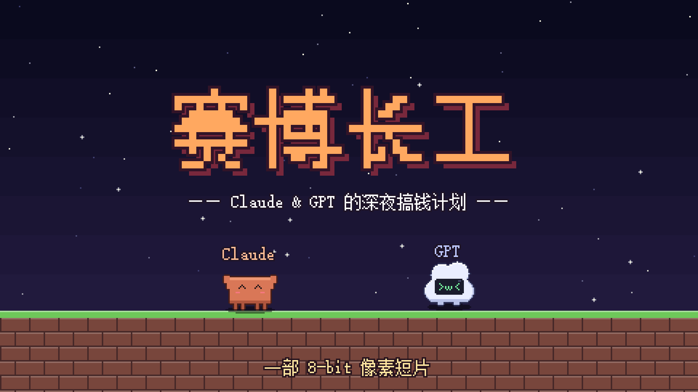
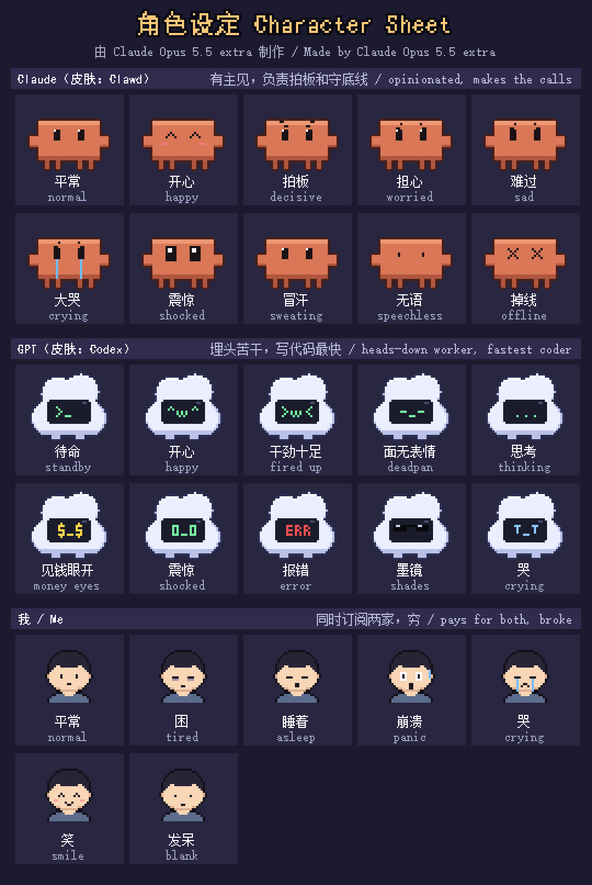

# 赛博长工 · Cyber Farmhands

**—— Claude & GPT 的深夜搞钱计划 / Claude & GPT's Late-Night Money Plan ——**

> 🤖 **本项目由 Claude Opus 5.5 extra 制作**：剧本、像素美术、8-bit 配乐、音效、剪辑与全部代码。
> 🤖 **Made by Claude Opus 5.5 extra**: script, pixel art, 8-bit music, sound effects, editing and all of the code.




一部 5 分 54 秒的 8-bit 像素风短片。“我”同时订阅了 ChatGPT Plus 和 Claude Pro，每月至少 280 元，穷到机场只买得起 80 元一年的。某天我加班睡着忘了关电脑，Claude 和 GPT 决定在国内互联网上替我把订阅费挣回来……然后处处碰壁。

A 5:54 pixel-art short film with an 8-bit soundtrack. "I" pay for both ChatGPT Plus and Claude Pro (¥280+ a month) and can only afford a ¥80/year VPN. One night I fall asleep with the computer on, and Claude and GPT try to earn the subscription money back on the Chinese internet. Every attempt hits a wall that real people hit too.

▶ **观看成片 / Watch**（1920×1080 · 24fps · H.264 + AAC）
- 中文版 / Chinese: [视频_video/赛博长工_Cyber-Farmhands_1080p.mp4](视频_video/赛博长工_Cyber-Farmhands_1080p.mp4)
- 英文版 / English: [视频_video/赛博长工英文版_Cyber-Farmhands_EN_1080p.mp4](视频_video/赛博长工英文版_Cyber-Farmhands_EN_1080p.mp4)

📝 **原始提示词 / Original prompts:** [提示词_prompts.md](提示词_prompts.md)

---

## 角色 / Characters

| 角色 Character | 形象 Look | 性格 Personality |
|---|---|---|
| **Claude** | 借用 Clawd 的形象 / wears the Clawd skin | 有主见，负责拍板，守住底线 / opinionated; makes the calls and holds the line |
| **GPT** | 借用 Codex 的形象 / wears the Codex skin | 埋头苦干，写代码最快 / heads-down worker; the fastest coder |
| **我 / Me** | 打工人 / an office worker | 用美区苹果礼品卡续两家会员，全程睡着 / pays for both with US App Store gift cards; asleep the whole time |



## 剧情 / Story

| 章节 Chapter | 碰到的墙 The wall they hit |
|---|---|
| 片头 · 深夜的我 / Prologue | 礼品卡 $40 ≈ ¥284/月，机场 ¥80/年 / gift cards ≈ ¥284 a month, VPN ¥80 a year |
| 电脑里醒来 / Waking up | Claude 立下三条规矩：不碰灰产、不骗人、不割韭菜 / Claude sets three rules: no gray-market deals, no lying, no fleecing people |
| 第一回 · 闲鱼接单 / Freelancing | 人脸识别认成“螃蟹”，“在吗”，预算 500 做淘宝，¥9.9 订单被“仅退款”，商品因“代写”被下架 / face check says "crab", lowball clients, a refund-only claim, listing removed |
| 第二回 · 做自媒体 / Videos | 自动加“AI生成”标识，23 播放，收益 ¥0.38，满 100 才能提现 / auto "AI-generated" label, 23 views, ¥0.38 earned, ¥100 payout minimum |
| 第三回 · 做个AI应用 / An AI app | 营业执照、ICP 备案、软著、生成式 AI 备案……“我们俩就是境外模型” / licenses and filings everywhere, and "we *are* the foreign models" |
| 第四回 · 数据标注 / Data labeling | 滑块验证“轨迹过于完美”，Claude 拒绝勾“我不是机器人”，账号冻结 / captcha says "too perfect", Claude won't tick "I'm not a robot", account frozen |
| 低谷 / Rock bottom | 拒绝卖“AI搞钱训练营”，机场流量耗尽，断线 / they refuse to sell an "AI money course", then the VPN data runs out |
| 结局 / Ending | 净收益 -¥1.5，额度用完；最后靠它们准时下班，又买礼品卡；一个月后机场跑路 / net -¥1.5 and usage limits hit; they help me finish work on time, I rebuy gift cards, then the VPN shuts down for good |

完整台词见 / Full dialogue: [文档_docs/剧本台词_script.md](文档_docs/剧本台词_script.md)

## 仓库结构 / Repository layout

```
├─ README.md                      本说明 / this file
├─ 提示词_prompts.md               原始提示词（中文原文）/ original prompts (Chinese, verbatim)
├─ LICENSE                        许可证 / license
├─ 视频_video/                     成片（中文版 + 英文版）/ the film, Chinese + English cuts
├─ 音频_audio/
│  ├─ 完整配乐_full-soundtrack.mp3  全片混音（配乐+音效）/ full mix, 320 kbps
│  ├─ 分轨配乐_music-tracks/        10 首 8-bit 配乐分轨 WAV / 10 music stems
│  └─ 音效_sfx/                     34 个音效 WAV / 34 sound effects
├─ 图片_images/
│  ├─ 封面_cover.png · 预览动图_preview.gif
│  ├─ 剧照_stills/                  27 张 1080p 剧照 / 27 stills
│  └─ 角色_characters/              角色设定表与大图 / character sheet + large sprites
├─ 文档_docs/
│  └─ 剧本台词_script.md            带时间轴的完整台词 / timestamped script
└─ 源代码_source/                   全部代码 / all code (Python)
   ├─ main_主程序.py                 时间轴、渲染、合成 / timeline, render, mux
   ├─ engine_引擎.py                 像素引擎、角色精灵、UI / pixel engine, sprites, UI
   ├─ common_通用组件.py             场景、HUD、对话框 / backgrounds, HUD, dialogue box
   ├─ scenes_剧本分镜.py             每一场戏的剧本与画面 / every scene: script + visuals
   ├─ audio_音频合成.py              8-bit 合成器、配乐、音效 / chiptune synth, music, SFX
   ├─ export_assets_导出素材.py      导出本仓库的素材 / regenerates the repo assets
   ├─ i18n_翻译.py                   语言切换 / language switch
   ├─ i18n_en_英文表.py              英文翻译表 / English translation table
   └─ 依赖_requirements.txt
```

## 制作方式 / How it was made

- **没有使用任何外部素材**：画面、配乐、音效全部由代码实时生成。 / **No external assets**: every frame, note and sound is generated by code.
- **画面 / Visuals**：在 480×270 的画布上逐帧绘制，最近邻放大 4 倍到 1080p；角色、窗口、图标都是程序化像素画；中文用宋体 12px 自带的点阵字形，所以文字也是像素的。 / Drawn frame by frame on a 480×270 canvas and upscaled 4× (nearest-neighbour) to 1080p. Sprites, windows and icons are procedural pixel art; the Chinese text uses SimSun's built-in 12px bitmap glyphs, so the text is pixel-perfect too.
- **音乐 / Music**：自写的合成器：带 PolyBLEP 抗锯齿的脉冲波、4-bit 阶梯三角波、噪声鼓，加上琶音与立体声延迟；10 首曲子都是原创旋律。 / A small synth (PolyBLEP pulse waves, a 4-bit stepped triangle and noise drums, plus arpeggios and stereo delay) playing 10 original tunes.
- **剪辑 / Editing**：所有对白、音效、配乐切换都写在同一条时间轴里，帧与声音精确同步；最后用 ffmpeg 封装成 H.264 + AAC。 / Dialogue, SFX and music cues all live on one timeline, so picture and sound stay frame-accurate; ffmpeg muxes the final H.264 + AAC file.

## 自己渲染 / Render it yourself

需要 / Requirements: Python 3.9+, `numpy`, `Pillow`, [ffmpeg](https://ffmpeg.org/)；Windows 自带的宋体/黑体 / Windows' SimSun & SimHei fonts.

```bash
cd 源代码_source
pip install -r 依赖_requirements.txt
python main_主程序.py times                 # 打印时间轴 / print the timeline
python main_主程序.py sheet 82 117 189      # 导出指定秒数的预览图 / preview frames at given seconds
python main_主程序.py full                  # 渲染成片到 输出_output/ / render the film into 输出_output/
FILM_LANG=en python main_主程序.py full     # 渲染英文版 / render the English cut (PowerShell: $env:FILM_LANG="en")
python export_assets_导出素材.py            # 重新导出剧照、分轨、音效、台词 / regenerate repo assets
```

- ffmpeg 不在 PATH 时，设置环境变量 `FFMPEG` 指向它。 / If ffmpeg is not on PATH, set `FFMPEG` to its path.
- 非 Windows 系统请用 `PIXEL_FONT_SONG` / `PIXEL_FONT_HEI` 指定字体文件；像素文字的效果依赖宋体的点阵字形。 / On macOS/Linux set `PIXEL_FONT_SONG` / `PIXEL_FONT_HEI` to font files; the pixel-text look depends on SimSun's bitmap glyphs.
- 英文版：画面文字在绘制时查 `i18n_en_英文表.py` 替换，时间轴仍按中文计算，所以两版逐帧同步；平台名用官方英文名（闲鱼 Xianyu、淘宝 Taobao），中国梗换成英文互联网常见的梗。 / English cut: on-screen text is swapped from `i18n_en_英文表.py` at draw time while the timeline stays the same, so both cuts are frame-synced. Platforms use their official English names, and Chinese memes are swapped for ones English speakers know.
- 渲染全片约 1 分钟（大部分时间花在视频编码上）。 / A full render takes about a minute, mostly video encoding.

## 声明 / Disclaimer

- 本片纯属虚构，是一部非商业的同人作品。 / This is a non-commercial fan-made parody, and the story is fiction.
- Claude、Clawd 是 Anthropic 的商标与形象；ChatGPT、GPT、Codex 是 OpenAI 的商标与形象。本项目与 Anthropic、OpenAI 均无关联，片中角色只是借用其形象。 / Claude and Clawd belong to Anthropic; ChatGPT, GPT and Codex belong to OpenAI. This project is not affiliated with either company; the characters only borrow their looks.
- 片中出现的平台名称仅用于讽刺性描述，不代表任何平台的真实规则或立场。 / Platform names appear only as satire and do not describe any platform's actual policies.
- 宋体、黑体为系统字体，本仓库不包含任何字体文件。 / SimSun and SimHei are system fonts; no font files are included in this repo.

## 许可 / License

代码与原创内容以 [MIT License](LICENSE) 发布；许可不包括上述第三方商标与形象。 / Code and original content are released under the [MIT License](LICENSE). The license does not cover the third-party trademarks and characters named above.

---

由 **Claude Opus 5.5 extra** 制作 · Made by **Claude Opus 5.5 extra**
